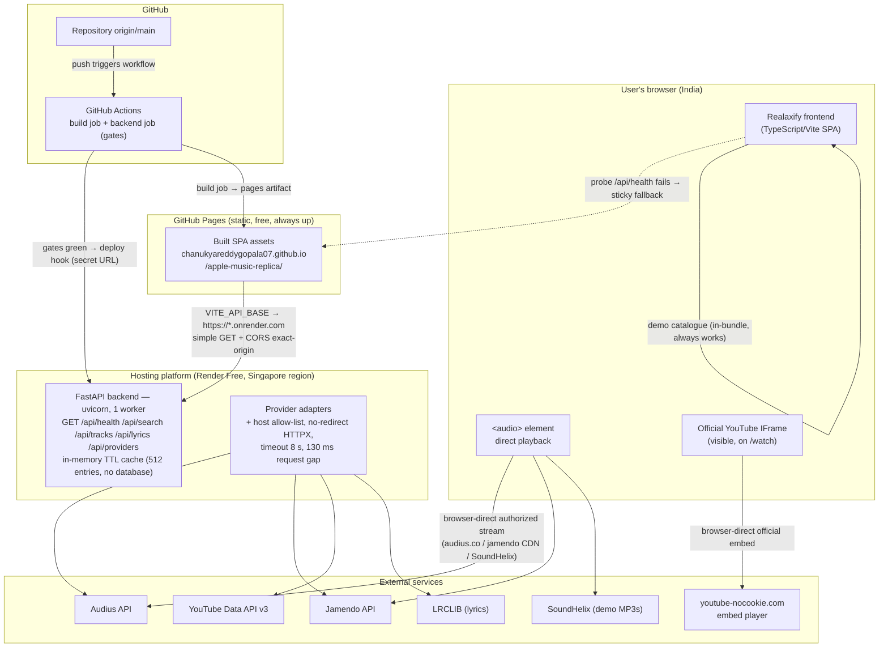

# Realaxify — Production Hosting Architecture and Deployment Plan (Stage G1)

**Status:** planning only — no accounts created, no resources provisioned, no billing enabled,
no code or workflow changes, nothing deployed.
**Research date:** 2026-10-30 (all platform claims verified against official pages on this date;
free tiers change often — re-verify before implementing).
**Repository:** https://github.com/chanukyareddygopala07/apple-music-replica
**Live site (must remain available as fallback):** https://chanukyareddygopala07.github.io/apple-music-replica/

---

## 1. Executive recommendation

**Primary architecture: Option C — keep the frontend on GitHub Pages, host the FastAPI backend
on Render's Free web service plan (Singapore region).**

- **Cost: $0/month, no credit card, no billing account.** Render's free web service
  (0.1 vCPU / 512 MB, spins down after 15 idle minutes) is enough for this API: it is
  stateless, has no database, and the frontend is *already designed* to work without it
  (`apiAvailable()` probes `/api/health` once and falls back to direct browser providers).
- **Zero frontend risk.** GitHub Pages keeps serving the current site unchanged; the API is a
  pure enhancement. If the backend sleeps, fails, or is misconfigured, users get today's
  behaviour (direct Audius + demo catalogue) — the fallback path is already tested.
- **No CORS redesign needed.** The backend already takes an exact-origin `CORS_ORIGINS`
  allow-list with `allow_credentials=False`; we add the Pages origin and set the build-time
  `VITE_API_BASE` to the Render URL.
- **Best free-tier fit of everything researched** (comparison in §3–§4): Render and Koyeb are
  the only two genuinely free, no-card, permanent free-instance Python hosts still standing in
  2026; Render wins because it offers a Singapore region (closest free option to Indian users),
  free custom domains + managed TLS, deploy hooks for CI-gated releases, and instant rollbacks.

**Backup architecture: Option B — single-origin (FastAPI serves the built frontend), on Render's
Hobby plan ($7/month, always-on) when cold starts become unacceptable.**
This requires a small future code change (mount `dist/` as static files) and is deliberately
deferred. **Infrastructure backup:** Koyeb's free instance (Frankfurt, sleeps after 1 h) as a
drop-in replacement for Render. **Future upgrade (needs billing approval):** Google Cloud Run in
`asia-south1` (Mumbai) — best latency and an always-free usage quota, but it requires a credit
card on file, which this milestone explicitly forbids.

**Actual cost implication of the recommended path: $0** — provided no payment method is attached
to the Render workspace (bandwidth overages are then *suspended*, never billed) and the single
free service stays within 750 free instance-hours/month (744 h = a full 31-day month; it fits,
with ~6 h margin).

---

## 2. Current architecture assessment (inspected, not assumed)

### 2.1 Repository and Git state (verified 2026-10-30)

| Item | State |
|---|---|
| Branch | `main`, **ahead of `origin/main` by 1 commit** (`de677f1 feat: complete Realaxify Python-backed migration`) |
| Remote | `origin` → `https://github.com/chanukyareddygopala07/apple-music-replica.git` (unchanged) |
| Uncommitted local work | `forgeagent/` (unrelated user subproject — must not be disturbed) |
| Production site today | GitHub Pages build of `origin/main` (`80528a0`), i.e. **pre-migration frontend** |
| Pages pipeline | `.github/workflows/deploy-pages.yml`: `build` job (lint → typecheck → unit → Playwright → Pages artifact) **and** `backend` job (ruff → pytest → Playwright API-E2E); `deploy` needs **both** |

### 2.2 Backend runtime facts (from `backend/`)

- **Production server command:** `uvicorn app.main:app --host 0.0.0.0 --port ${PORT:-8000}`
  run **from `backend/`**, single worker (the cache is in-process; multiple workers would
  fragment it), **no `--reload`** in production. The app itself never reads `PORT` — the
  platform's injected port must be passed explicitly (Render sets `PORT`; Koyeb expects a
  configurable port, default 8080).
- **Python:** `requires-python = ">=3.11"` (`backend/pyproject.toml`). CI runs 3.12; local lock
  was generated on 3.13. Recommend pinning the deployment runtime to **3.12** to match CI.
- **Production dependencies:** `fastapi`, `uvicorn[standard]`, `httpx`, `pydantic` (dev extras:
  pytest, pytest-asyncio, ruff — not needed at runtime). `backend/uv.lock` exists for
  reproducible installs.
- **Startup/shutdown:** FastAPI `lifespan` creates one shared `httpx.AsyncClient`
  (redirects disabled), the TTL cache, and the four provider adapters; shutdown closes the
  client. No background tasks, no workers, no queues.
- **Health endpoint:** `GET /api/health` → HTTP 200 JSON
  `{status:"ok", service:"realaxify-api", version, uptime_seconds, providers:[…]}` — suitable as
  the platform health-check path.
- **Database:** **None.** Despite the brief mentioning "SQLite where appropriate", the actual
  implementation has *no* database and *no* filesystem writes — only a bounded in-memory TTL
  cache (`CACHE_MAX_ENTRIES=512`, search TTL 60 s, negative TTL 15 s). Ephemeral free-tier disks
  are therefore fine, and free-tier filesystem resets are harmless. If listening-history/local
  stats are ever added (planned M5 in `replica/mvp-reference-plan.md`), *then* persistence
  becomes a requirement — and SQLite files would be lost on Render free (no persistent disk on
  the free plan; free Render Postgres expires after 30 days), so that future feature must not be
  designed against free-tier storage.
- **Local filesystem assumptions:** none (only `os.environ` reads in `config.py`).

### 2.3 Frontend ↔ backend contract (verified)

- Build-time public config: `VITE_API_BASE` (API origin, default = same origin),
  `VITE_API_ENABLED` (`0` never / `1` always / unset = one `GET /api/health` probe per tab
  session with **sticky fallback** to direct browser providers on failure),
  `VITE_API_PROXY` (dev-only).
- For Option C the Pages build must set `VITE_API_BASE=https://<render-service>` and leave
  `VITE_API_ENABLED` unset (probe) or `1`.
- Playback paths stay as they are: **direct audio** streams from provider-authorized URLs
  (`<audio>` follows Audius/Jamendo redirects), **YouTube plays only in the official visible
  IFrame player** on `/watch` (privacy-enhanced embed, never proxied, never backgrounded).

### 2.4 CORS and secrets

- CORS: exact origins from `CORS_ORIGINS`, `allow_credentials=False`, methods `GET, OPTIONS`,
  headers `Accept, Content-Type`, `max_age=600`. Production needs exactly one added origin:
  `https://chanukyareddygopala07.github.io` (scheme+host origin only — never a path).
- **No endpoint exposes secrets:** `/api/providers` returns `ProviderInfo {id, name,
  description, configured, status, message, capabilities}` — booleans and human-readable
  messages only; there is no schema field for `api_key`/`client_id` anywhere in
  `backend/app/models/schemas.py`. Error paths strip upstream query strings (`safe_url`) and
  redact credential-bearing params (`_redact`) before anything can reach a log or response.
- Provider credentials exist **only** in server-side environment variables
  (`YOUTUBE_API_KEY`, `JAMENDO_CLIENT_ID`, optional `AUDIUS_API_KEY`).

---

## 3. Hosting-platform comparison (official docs, checked 2026-10-30)

Legend: ✅ permanent free offering · ⚠️ free but limited/ephemeral · ❌ trial only or paid · 💳 = requires payment method on file.

| Platform | Python / FastAPI | Free tier (2026-10-30) | Sleep / cold start | Free regions (latency to India) | HTTPS + domain | GitHub integration | Card required? | Verdict |
|---|---|---|---|---|---|---|---|---|
| **Render** | ✅ native (Python build, FastAPI listed) | ✅ Free web service 0.1 vCPU / 512 MB, 750 instance-h/month, custom domains + TLS, rollbacks to 2 recent deploys ([docs/free](https://render.com/docs/free)) | ⚠️ spins down after **15 min** idle, wakes in **~1 min** | Oregon, Ohio, Virginia, **Frankfurt, Singapore** — free-tier components listed for Oregon/Ohio/Frankfurt/Singapore ([regions](https://render.com/docs/regions), [status](https://status.render.com/)) | ✅ free (incl. custom domains on free plan) | ✅ Git auto-deploy + **deploy hooks** for CI gating ([deploy-hooks](https://render.com/docs/deploy-hooks)) | ❌ not needed (but attaching one enables bandwidth billing — see §4) | **★ Primary pick** |
| **Koyeb** | ✅ (buildpack or Dockerfile) | ✅ 1 free instance/org: 0.1 vCPU, 512 MB, 2 GB SSD; 100 GB outbound free; "you will never be charged for the free Service" ([FAQ](https://www.koyeb.com/docs/faqs/pricing)) | ⚠️ scales to zero after **1 h** idle (free instance; cannot be disabled) ([scale-to-zero](https://www.koyeb.com/docs/run-and-scale/scale-to-zero)) | **Frankfurt or Washington D.C. only** — no Singapore on free | ✅ auto `*.koyeb.app` + TLS on all apps; custom domains positioned on paid plans (Pro includes 100) ([apps](https://www.koyeb.com/docs/reference/apps), [pricing FAQ](https://www.koyeb.com/docs/faqs/pricing)) | ✅ GitHub App, auto-redeploy on push ([deploy-with-git](https://www.koyeb.com/docs/build-and-deploy/deploy-with-git)) | ❌ not needed for free instance | **Backup infra** |
| **Railway** | ✅ (nixpacks/Docker) | ⚠️ "Free" plan = **$1/month non-rollover credit**, then services auto-shutdown; 0.5 GB RAM ceiling ([plans](https://docs.railway.com/pricing/plans)) — 0.5 GB always-on costs $5/mo of usage > $1, so it cannot stay up ([free plan post](https://blog.railway.com/p/free-plan)) | ❌ no sleep (runs until credit exhausts) | Washington D.C. default (paid custom regions) | ✅ auto HTTPS | ✅ native | ❌ for Free; 💳 for Hobby ($5/mo incl. $5 usage) | ❌ free credit too small for an always-on service |
| **Google Cloud Run** | ✅ (container) | ⚠️ **always-free usage quota** (e.g. 240k vCPU-s + 450k GiB-s + 2M requests per month) but **the project must have billing enabled** — a card is required ([pricing](https://cloud.google.com/run/pricing), [billing prerequisite](https://docs.cloud.google.com/deploy/docs/deploy-app-verification)) | ✅ scale-to-zero; wakes on request | **Mumbai `asia-south1`** available — best in India | ✅ free managed TLS | ✅ via `google-github-actions` + Cloud Build | 💳 **Yes (billing account mandatory)** | ⚠️ best latency, but violates the no-card boundary — future upgrade only |
| **PythonAnywhere** | ✅ (WSGI; FastAPI via manual config) | ⚠️ "Beginner $0": 1 web app (**1-month expiry** for idle apps), 100 CPU-s/day, 512 MB, **restricted outbound to an allow-list** ([free accounts](https://help.pythonanywhere.com/pages/FreeAccountsFeatures/), [Jan 2026 changes](https://blog.pythonanywhere.com/221/)) | ❌ always on (tiny CPU budget) | EU/US hosts (no India region) | ✅ free SSL; custom domain paid-only | ❌ no git-based deploys | ❌ | ❌ **disqualified:** allow-list verified on 2026-10-30 to include `googleapis`/`jamendo`/`youtube` but **not `audius` or `lrclib.net`** → core providers would be blocked; also paid tier now $10/mo |
| **Hugging Face Spaces** | ⚠️ Docker Spaces exist, but since **July 2026 creating any compute Space (Gradio/Docker, incl. free CPU Basic) requires a paid PRO plan** ([spaces-overview](https://huggingface.co/docs/hub/spaces-overview), [hub-docs PR #2624](https://github.com/huggingface/hub-docs/pull/2624)) | Static Spaces free; compute gated behind PRO ($9/mo) | ⚠️ free hardware sleeps after ~48 h | US/EU (US-East default) | ✅ `*.hf.space` / custom on paid | ✅ Git push | 💳 for any compute | ❌ not free for FastAPI any more |
| **Fly.io** | ✅ (Docker/Machines) | ❌ no free tier for new orgs; trial = 2 h runtime / 7 days ([pricing](https://docs.fly.io/about/pricing), [free trial](https://docs.fly.io/about/free-trial)) | ❌ (pay per running second) | No Mumbai region in lowest-price tier (APAC egress $0.04/GB; India egress $0.12/GB) | ✅ first 10 host certs free | ✅ | 💳 yes | ❌ card mandatory, $2.19/mo minimum always-on |
| GitHub Pages (existing, static) | n/a (static only) | ✅ permanent free | n/a (always available) | Global CDN — fine for India | ✅ automatic | ✅ native (existing workflow) | ❌ | ✅ **retained as frontend + fallback** |

### Outbound-connectivity notes (verified)

- **Render free:** unrestricted outbound internet (only SMTP ports 25/465/587 blocked) — Audius,
  Jamendo, Google APIs and LRCLIB all reachable.
- **Koyeb free:** unrestricted outbound; 100 GB/month free egress, then $0.04/GB.
- **PythonAnywhere free:** allow-list only (verified — see table) → incompatible.

---

## 4. Free-tier and pricing comparison (official references)

| Platform | Permanently free? | Specs | Key limits | Charge risks |
|---|---|---|---|---|
| Render Hobby/Free | **Yes** (permanent free *plan*, but docs say "do not use Free instances for production") | 0.1 vCPU, 512 MB | 750 free instance-h/workspace/month; spins down after 15 min; ephemeral FS; no scaling; rollback limited to 2 previous deploys; 5 GB bandwidth included on Hobby ([pricing](https://render.com/pricing), [docs/free](https://render.com/docs/free)) | Suspending-not-billing while no card is attached; **if a card is added**: bandwidth over $0.15/GB and build minutes overage bill automatically. Never attach a card for the MVP path. |
| Render Hobby paid | No — $0 plan fee + compute | 0.5 CPU/512 MB = **$7/mo**, never sleeps ([compute plans](https://render.com/docs/compute-plans)) | 5 GB bandwidth incl., then $0.15/GB | Usage billed on the attached card |
| Koyeb free instance | **Yes** (1 per org) | 0.1 vCPU, 512 MB, 2 GB SSD | Frankfurt/DC only; scale-to-zero after 1 h; no volumes/workers/custom scaling | "You will never be charged when using the free Service" (official FAQ); charges only start if you deploy non-free instances or attach a card and exceed free bandwidth |
| Koyeb Starter/pay-as-you-go | No monthly fee | eco instance from **$1.61/mo** (0.1 vCPU/256 MB) | Per-second billing; 100 GB egress free/month | Scales can surprise if min-scale > 0 on paid instances |
| Railway Free | Partial — $1/mo credit | ≤0.5 GB | Credit exhausts → auto-shutdown; no overage possible on Free ([plans](https://docs.railway.com/pricing/plans)) | Cannot charge on Free; Hobby $5/mo + overage bills a card |
| Cloud Run | Quota-free, **not card-free** | usage-based | Free tier (240k vCPU-s/450k GiB-s/2M req monthly instance-based; 180k/360k/2M request-based); billing account mandatory ([pricing](https://cloud.google.com/run/pricing)) | Beyond-quota usage, egress, and any `min-instances` idle time bill the card; budget alerts recommended |
| PythonAnywhere Beginner | Yes (reduced Jan 2026) | 100 CPU-s/day | Outbound allow-list; 1-month app expiry; no MySQL/scheduled tasks for new free users | No auto-charges (subscription only; Developer now $10/mo) |
| HF Spaces compute | **No** since Jul 2026 (static only free) | CPU Basic free *if* you have PRO | Creating Gradio/Docker Spaces needs PRO $9/mo ([pricing](https://huggingface.co/pricing)) | Subscription |
| Fly.io | No | smallest always-on $2.19/mo | Card on file required | Per-second billing; pre-auth hold |

**Summary:** the only platforms that host this FastAPI backend **permanently free with no card**
are **Render** and **Koyeb** (and Railway's $1 credit, which is too small to keep a service up).
PythonAnywhere and HF Spaces are disqualified on current terms; Cloud Run is disqualified only by
the no-card rule, not by capability.

---

## 5. Recommended architecture (Option C) and backup (Option B)

### Option A — Separate frontend and backend (generic)

Frontend static host + FastAPI on a Python host, `VITE_API_BASE` set to the API origin, strict
CORS. Cost $0 on Render/Koyeb free static + free web service. Two pipelines, cross-origin
requests (simple GETs; preflight only if custom headers are sent).

### Option B — Single-origin

FastAPI serves `dist/` (e.g. `app.mount("/", StaticFiles(...))` + SPA fallback), API under
`/api/*`, **no CORS at all**, one deploy unit, page loads wake the service.

- Pros: simplest browser security model; one origin; no probe/fallback complexity.
- Cons: **requires a code change** (not done in this milestone); on a *free sleeping* instance
  every cold start costs the visitor ~1 minute for the **first page load** (HTML comes from the
  sleeping service), which is worse than Option C's model; static assets would be served from
  0.1 vCPU with no CDN; frontend and backend deploys become coupled; the current Pages site
  must still run in parallel during migration anyway.
- Best used **on an always-on plan** (Render Hobby $7/mo) where cold starts disappear.

### Option C — Retain GitHub Pages + separate backend (recommended)

Pages keeps serving the identical frontend (unchanged URL, unchanged pipeline, unchanged
fallback). The backend is deployed separately and referenced by `VITE_API_BASE`. The client's
existing design (`apiAvailable()` probe → sticky fallback) makes the split *degrade by design*.

| Axis | Option A (generic split) | Option B (single origin) | **Option C (Pages + API)** |
|---|---|---|---|
| Cost | $0 free tiers | $0 free (bad cold starts) / **$7/mo always-on** | **$0** |
| Complexity | Two hosts, CORS | One host, needs code change | Two hosts, CORS (one origin entry) |
| Security | GET-only, no cookies; CORS exact | Smallest surface (no CORS) | Same as A (verified minimal: no credentials) |
| Performance | Static fast, API may sleep | Fastest when always-on; worst cold start when free | **Static always fast; API degrades gracefully** |
| Reliability | Backend outage ≠ site outage | Backend outage = site down | **Same as A, plus proven fallback path** |
| Deploy effort | Medium | Medium-high (code + pipeline) | **Lowest (env vars only)** |
| Fallback site | Optional | Must be kept separately | **The existing site *is* the fallback** |

**Decision:** Option C primary (§1). Option B is the designed backup once (a) a backend outage
or API sleep must no longer be survivable, or (b) an always-on $7/mo plan is approved —
implemented in a later code milestone, not this one. **Koyeb free** is the infrastructure-level
backup (same Option C shape, different provider). **Cloud Run Mumbai** is the latency upgrade
(needs explicit billing approval).

---

## 6. Deployment architecture diagram



**Server-side requests (need credentials):** API → Audius, Jamendo, YouTube Data API, LRCLIB.
**Browser-side playback (no credential in the API path):** `<audio>` → Audius/Jamendo/SoundHelix
authorized URLs; YouTube → official IFrame embed (never proxied through the backend).
**Credential notes:** `YOUTUBE_API_KEY` and `JAMENDO_CLIENT_ID` live only in the Render service
environment (private); `AUDIUS_API_KEY` optional/private (anonymous works); LRCLIB needs none;
`VITE_*` build variables are public by construction and must never contain secrets; the Render
**deploy-hook URL is a secret** (stored as a GitHub Actions secret). Demo catalogue is
browser-side (in-bundle) — it never touches the backend.

---

## 7. Exact production start/build commands

### Backend service (Render — service root `backend/`)

| Phase | Command |
|---|---|
| Build | `pip install uv && uv sync --frozen --no-dev` (deterministic from `backend/uv.lock`; alternative: `pip install .`) |
| Start | `uvicorn app.main:app --host 0.0.0.0 --port ${PORT:-8000}` (single worker, no `--reload`) |
| Health check path | `/api/health` (expects HTTP 200, `status:"ok"`) |
| Python version | pin 3.12 (matches CI; `>=3.11` supported) |

(Koyeb equivalent: expose port 8080, same start command with `--port 8080`.)

### Frontend build for the API-enabled production (GitHub Pages job — later, when approved)

```bash
VITE_BASE=/apple-music-replica/ \
VITE_API_BASE=https://<render-service>.onrender.com \
VITE_API_ENABLED= \            # unset = one /api/health probe per session, sticky fallback
npm run build                  # + existing cp dist/index.html dist/404.html
```

Direct-provider browser keys (`VITE_JAMENDO_CLIENT_ID`, `VITE_YOUTUBE_API_KEY`) should stay
**empty** in the API-mode build so credentials live server-side only; Audius stays anonymous +
demo catalogue remains the always-on base.

### Local parity (unchanged)

- Frontend: `npm run dev` / `npm run preview` (dev proxy `/api` → `127.0.0.1:8000`).
- Backend: `cd backend && uvicorn app.main:app --reload --port 8000`.

---

## 8. Environment-variable checklist

### Server-side — PRIVATE (Render environment; never committed, never returned)

| Variable | Purpose | Prod value |
|---|---|---|
| `YOUTUBE_API_KEY` | YouTube Data API v3 search (server-side only) | provision + set (secret) |
| `JAMENDO_CLIENT_ID` | Jamendo read API (free id from devportal) | provision + set (secret-ish; never in bundle) |
| `AUDIUS_API_KEY` | optional Audius free-plan key | optional (anonymous default works) |
| `CORS_ORIGINS` | exact allowed browser origins | `https://chanukyareddygopala07.github.io` (+ localhost for tests) |
| `APP_ENV` | environment label | `production` |
| `LOG_LEVEL` | log verbosity | `info` (never `debug` with upstream URLs) |
| `HTTP_TIMEOUT_S` | upstream timeout | `8` (default) |
| `CACHE_TTL_S` / `CACHE_NEGATIVE_TTL_S` / `CACHE_MAX_ENTRIES` | in-memory cache | `60` / `15` / `512` (defaults) |
| `PROVIDER_REQUEST_GAP_MS` | provider courtesy gap | `130` (default; ≥ provider rate limits) |
| `MAX_QUERY_LENGTH` / `SEARCH_LIMIT` / `MAX_CONCURRENT_SOURCES` | input + fan-out limits | `200` / `20` / `4` (defaults) |
| `AUDIUS_ENABLED` / `JAMENDO_ENABLED` / `YOUTUBE_ENABLED` / `LYRICS_ENABLED` | provider switches | `1` (or `0` to disable) |
| `AUDIUS_BASE_URL` / `JAMENDO_BASE_URL` / `YOUTUBE_BASE_URL` / `LRCLIB_BASE_URL` | upstream hosts (also the SSRF allow-list) | defaults — leave unset |
| `PORT` | listen port | injected by platform (do not hardcode) |

### Browser / build-time — PUBLIC (baked into the JS bundle; secrets forbidden)

| Variable | Purpose | Prod value |
|---|---|---|
| `VITE_API_BASE` | API origin | `https://<render-service>.onrender.com` |
| `VITE_API_ENABLED` | `0`/`1`/unset probe policy | unset (probe) or `1` |
| `VITE_BASE` | Pages subpath | `/apple-music-replica/` |
| `VITE_AUDIUS_ENABLED` (+ key, if ever) | direct-mode Audius | enabled, anonymous (key optional/public only) |
| `VITE_JAMENDO_CLIENT_ID` | direct-mode Jamendo | **empty** in API-mode prod (key is server-side) |
| `VITE_YOUTUBE_API_KEY` | direct-mode YouTube search | **empty** in API-mode prod (key is server-side) |
| `VITE_MUSICKIT_*` | optional MusicKit gate | unchanged/empty |
| `VITE_API_PROXY` | dev proxy only | unset in CI/production |

### CI/CD secrets (GitHub Actions secrets — not `vars`)

`RENDER_DEPLOY_HOOK_URL` (or provider API token) — deploy trigger; secret URL per Render docs.

**Verification of exposure:** `GET /api/providers` and all response models were inspected — no
credential fields exist in any Pydantic response schema; upstream URLs are stripped to
origin+path before logging/serialization; the 500 handler returns a bare body.

---

## 9. Security considerations (verified vs. planned)

**Verified in the current code (facts, not claims):**

1. **No API-key exposure:** credentials only in env; responses carry `configured: bool` +
   human messages; `safe_url`/`_redact` scrub query strings from any logged/returned URL.
2. **SSRF:** fetcher rejects non-http(s) and any host ≠ the configured base host
   (`_check_url`), `follow_redirects=False` — nothing in a request can retarget upstream calls.
3. **CORS:** exact-origin allow-list, no credentials, `GET`/`OPTIONS` only, short `max_age`.
4. **Oversized/invalid input:** middleware caps query strings (4096) and bodies (16 KB);
   path/query validation via Pydantic patterns and `MAX_QUERY_LENGTH`.
5. **Error handling:** catch-all handler logs path only (no payload) and returns a bare 500;
   provider failures surface as sanitized `Search failed: …` per-source groups.
6. **Env-file hygiene:** `.env*` gitignored except `*.example` (verified with `git check-ignore`);
   examples contain empty placeholders only.
7. **Transport:** HTTPS everywhere (Pages auto-TLS; Render/Koyeb managed TLS on their
   subdomains — free).
8. **No database ⇒ no public datastore** to leak or misconfigure.

**Known gaps (honest — to be addressed in later milestones, not claimed as done):**

- **No app-level per-client rate limiting/quotas.** The API is unauthenticated by design
  (read-only GET), so a scraper could burn provider quotas (YouTube: 100 searches/day).
  Mitigation plan: platform-level protection (Render free has no WAF), plus a future in-process
  token-bucket middleware or an edge rate limit if/when a domain/CDN is added.
- **Keep-alive vs. abuse:** if an Actions cron pings `/api/health` to prevent sleep, that is a
  deliberate design choice to document, not a hidden hack.
- **Third-party integrity:** `uv.lock` pins backend deps; npm lockfile pins frontend; no
  auto-update services.
- **Supply of keys:** YouTube key should additionally be restricted in Google Cloud
  (HTTP referrer restrictions don't apply to server key usage — use API-restriction to
  YouTube Data API v3 only + quota caps).
- Not verified (do not claim): penetration testing, dependency CVE scanning, Render's
  compliance posture for this workload.

---

## 10. CI/CD deployment proposal (design only — no workflow edits in this milestone)

**Current gates (kept intact — nothing weakened):**
frontend lint, frontend typecheck, frontend unit (356), frontend production build, frontend
Playwright (17), backend ruff check, backend pytest (83), backend API E2E (5). `deploy` already
requires `needs: [build, backend]`.

**Proposed additions (for a future implementation milestone):**

1. Add `uv run ruff format --check .` to the backend job (format verification is currently run
   manually but not enforced in CI).
2. Add a `deploy-backend` job: `needs: [build, backend]`, runs only on `main` pushes after all
   checks pass, then `curl -X POST "$RENDER_DEPLOY_HOOK_URL&ref=$GITHUB_SHA"` (Render officially
   documents exactly this Actions pattern; the hook URL is an Actions **secret**). Alternative:
   disable Render auto-deploy and always deploy an explicit SHA for traceability.
3. Preview behavior: PRs run the full gate set without deploying (all existing suites are
   credential-less by construction). Render's free plan lists "Service previews" — optional
   preview deploys can be enabled there later; Koyeb has no PR-preview story on free.
4. Keep the Pages `deploy` job exactly as it is (still gated on both jobs) — Pages is both the
   current production site and the rollback target.
5. Optional scheduled `health-ping` cron (every 10–12 min) *only if* keeping the free instance
   awake is accepted: it consumes the 750 instance-hour budget (a fully-awake month is 744 h ≤
   750 h — fits with ~6 h margin, and only one free service can be afforded).

**Rollout order:** checks green → backend deploy → backend smoke (`/api/health`, `test:e2e:api`
against the live URL) → then a *separate, approved* Pages build with `VITE_API_BASE` set.
Pages never changes until the backend is proven.

---

## 11. India-region latency considerations

Latency figures below are **estimates from geography/typical RTT, not measurements** — validate
with real probes during implementation (`curl` timings from an Indian network to
`/api/health`, plus WebPageTest).

| Hop | Option C (recommended) | Notes |
|---|---|---|
| User → frontend | GitHub Pages CDN (global edge) | static, always fast in India |
| User → API | Render **Singapore** ≈ lowest Render option for India (order-of-tens-of-ms to ~100+ ms RTT); Frankfurt fallback | choose **Singapore at service creation — region cannot be changed later** |
| API → providers | Singapore → Google APIs (multi-region, fast), Audius (US), Jamendo (EU), LRCLIB (host unknown) | affects *search* latency only; bounded by `HTTP_TIMEOUT_S=8` and 130 ms gaps |
| Playback | browser → Audius/Jamendo CDNs and youtube-nocookie directly | independent of API region; YouTube embed performance unchanged |

Alternatives ranked for India: **Cloud Run `asia-south1` (Mumbai)** ≈ best (card required) >
Render Singapore > Render Frankfurt ≈ Koyeb Frankfurt > Koyeb/Railway Washington D.C. (worst).
GitHub Pages stays latency-neutral in every option. Free-tier plan choice is therefore
Frankfurt-vs-Singapore on Render, and **Singapore should be selected**.

---

## 12. Migration plan from GitHub Pages (incremental, Pages never goes dark)

| Phase | Action | Exit criteria | Reversible? |
|---|---|---|---|
| 0 | **Push commit `de677f1`** (explicit approval required; `forgeagent/` stays uncommitted) | `origin/main` == local; existing Pages gates re-run green; site unchanged in behaviour | yes (git revert) |
| 1 | Create Render account + Free web service (root `backend/`, Singapore), set PRIVATE env vars, health path `/api/health`, no card attached | `curl https://<svc>.onrender.com/api/health` → `status:"ok"`; `npm run test:e2e:api` pointed at it | delete/suspend service |
| 2 | Set Actions **variable** `VITE_API_BASE` (+ keep `VITE_API_ENABLED` unset) and rebuild Pages via the existing workflow | live Pages build calls API; direct-provider fallback verified by stopping the API | remove variable → rebuild → exact old behaviour |
| 3 | Observe ≥ 1 week: sleep/wake UX, bandwidth, instance hours, provider quota | metrics within §4 limits | suspend API any time |
| 4 *(optional, approval needed)* | Option B single-origin (+ possible custom domain purchase) on Render Hobby $7/mo | one-origin smoke suite green | keep Pages as fallback indefinitely |

Nothing in phases 0–3 removes, redirects, or changes the GitHub Pages URL or pipeline.

## 13. Rollback strategy

1. **Frontend/API config rollback:** delete the `VITE_API_BASE` Actions variable and re-run the
   workflow → the site returns to today's direct-provider behaviour (the probe falls back
   sticky). This is the primary kill-switch and needs no backend action.
2. **Backend rollback:** Render keeps the **two most recent deploys** on the free plan with
   one-click rollback (official free-feature list); deploy hooks accept an explicit `ref` SHA,
   so `curl "$HOOK&ref=<last-good-sha>"` reproduces a known-good build.
3. **Full backend outage:** expected failure mode = frontend gracefully degrades (already
   tested by `catalog-facade` zero-network suites and the API-mode e2e); no user-facing error.
4. **Pages rollback:** `git revert` triggers the existing two-gate workflow — Pages redeploys
   the previous app automatically; Rollbacks of the Pages *artifact* also exist via the GitHub
   Pages deployment history.
5. **Platform walk-away:** because the backend is stateless (no DB, no volumes), migrating to
   Koyeb/Cloud Run later is "recreate service + env vars + repoint `VITE_API_BASE`" — minutes,
   no data migration.

## 14. Operational risks

| Risk | Likelihood/impact | Mitigation |
|---|---|---|
| Free instance sleeps (15 min idle → ~1 min wake) | high / low-medium | client probe already degrades gracefully; optional Actions keep-alive cron (fits 744 h ≤ 750 h budget) |
| 750 instance-hour/month exhaustion (workspace-wide) | low (only one free service) | monitor Render "Monthly Included Usage"; no second free service in the same workspace |
| 5 GB bandwidth/month overrun | low/medium | API responses are small JSON; if a card is attached this bills $0.15/GB — **do not attach a card**; Render suspends instead when cardless |
| Render free "not for production" disclaimer + arbitrary restarts | accepted for MVP | stateless service; Pages frontend unaffected; documented as accepted risk |
| YouTube quota exhaustion (100 searches/day free) | medium / low | quota alerts in Google Cloud; honest per-source error group already implemented |
| Provider API changes (Audius/Jamendo/LRCLIB) | medium / medium | per-source failure isolation (one source errors, others still answer); TTL caches soften spikes |
| Region immutability (wrong region chosen at creation) | low / high | pick Singapore first (§11) — services cannot be moved later |
| Free-tier terms change (checked 2026-10-30) | medium / medium | dual-vendor design (Render ↔ Koyeb drop-in); re-verify pricing each quarter |
| Split-brain between Pages build and API version | low / low | API is additive; domain mapping is 1:1 camelCase and versioned by `/api/health` |
| Single instance, no HA (free tier) | certain / low for MVP | accepted; documented; paid path = $7/mo single instance or Cloud Run autoscale |
| Loss of in-memory cache on restart | certain / negligible | caches are pure performance (60 s TTL), correctness unaffected |

## 15. Remaining blockers and unknowns

1. **Migration commit not pushed** (`main` ahead 1) — pushing requires explicit approval; Pages
   still serves the pre-migration build.
2. **No hosting accounts exist yet** (this milestone forbids creating them); all platform
   behaviors above are doc-verified, not account-verified (e.g., confirm in the Render dashboard
   that free instances are creatable in Singapore for a brand-new workspace, and whether the
   free plan accepts a health-check path).
3. **Provider credentials not provisioned:** free Jamendo client id and a YouTube Data API key
   (quota-capped) still need to be created — server-side only, via secrets, in a later milestone.
4. **Custom domain on Koyeb free** appears paid-plan-positioned (uncertain) — Render is preferred
   partly because free custom domains are explicitly documented.
5. **Cold-start tolerance** is a product decision: accept sleeps (free) vs. approve $7/mo
   always-on (Option B/Hobby).
6. **Keep-alive cron** (if used) is an ethical/policy judgment call to confirm with the owner.
7. **No performance/load testing** has been performed; 0.1 vCPU headroom for concurrent search
   fan-out is reasoned, not measured.
8. **Region reachability unmeasured** (all India latency figures are estimates).
9. Option B code change (static file serving + SPA fallback) and any domain purchase are
   explicitly out of scope for this milestone.

## 16. References (all accessed 2026-10-30)

**Render**
- Free instances: https://render.com/docs/free
- Pricing: https://render.com/pricing
- Compute plans: https://render.com/docs/compute-plans
- Web services: https://render.com/docs/web-services
- Regions: https://render.com/docs/regions (free-tier components: https://status.render.com/)
- Deploy hooks (GitHub Actions pattern): https://render.com/docs/deploy-hooks
- Deploys (build/start commands, zero-downtime): https://render.com/docs/deploys

**Koyeb**
- Pricing FAQ (free tier, custom domains): https://www.koyeb.com/docs/faqs/pricing
- Instances (free instance limits): https://www.koyeb.com/docs/reference/instances
- Scale-to-zero: https://www.koyeb.com/docs/run-and-scale/scale-to-zero
- GitHub deploy: https://www.koyeb.com/docs/build-and-deploy/deploy-with-git
- Apps/domains: https://www.koyeb.com/docs/reference/apps

**Railway**
- Plans: https://docs.railway.com/pricing/plans
- Free trial: https://docs.railway.com/pricing/free-trial
- Free-plan announcement: https://blog.railway.com/p/free-plan

**Google Cloud Run**
- Pricing/free tier: https://cloud.google.com/run/pricing
- Billing prerequisite: https://docs.cloud.google.com/deploy/docs/deploy-app-verification

**PythonAnywhere**
- Plans: https://www.pythonanywhere.com/pricing/
- Free-account features: https://help.pythonanywhere.com/pages/FreeAccountsFeatures/
- Jan-2026 free-tier changes: https://blog.pythonanywhere.com/221/
- Outbound allow-list (audius/lrclib absent): https://www.pythonanywhere.com/whitelist/

**Hugging Face**
- Spaces overview (compute gating): https://huggingface.co/docs/hub/spaces-overview
- Pricing: https://huggingface.co/pricing
- Compute-gating docs PR: https://github.com/huggingface/hub-docs/pull/2624

**Fly.io**
- Pricing: https://docs.fly.io/about/pricing
- Free trial: https://docs.fly.io/about/free-trial

**Repository (local inspection, 2026-10-30)**
- `backend/pyproject.toml`, `backend/app/main.py`, `backend/app/config.py`,
  `backend/app/api/*`, `backend/app/providers/base.py`, `backend/app/services/status.py`,
  `backend/app/models/schemas.py`, `backend/README.md`, `backend/.env.example`
- `.github/workflows/deploy-pages.yml`, `vite.config.ts`, `src/data/api-client.ts`,
  `README.md`, `.env.example`, `replica/mvp-reference-plan.md`

---

## 17. Staging deployment record — Stage G2 (executed 2026-10-30)

Live verification of the service created by the account holder. Sections 1–16 remain the
plan as written; this section records what was actually observed. *(Uncommitted per
instruction — commit only with explicit approval.)*

### 17.1 Service configuration

| Item | Value |
|---|---|
| Service name | `realaxify-api` |
| URL | **https://realaxify.onrender.com** (root; `realaxify-api.onrender.com` → 404) |
| Deployed code | `main` @ `dd968ea` (`fix: secure YouTube API key transmission`) at creation; **Auto-Deploy: Off** — later pushes do not redeploy |
| Root directory | `backend` (contains `pyproject.toml` + `uv.lock`; Render auto-detects uv) |
| Build command | `pip install uv && uv sync --locked --no-dev` (dry-run exit 0 before deploy) |
| Start command | `.venv/bin/uvicorn app.main:app --host 0.0.0.0 --port $PORT` |
| Health check path | `/api/health` (HTTP GET, 2xx required) |
| Instance / region | Free plan instructed; **region discrepancy — see §17.9** |

### 17.2 Environment variables (Render dashboard)

| Variable | Status | How verified |
|---|---|---|
| `PYTHON_VERSION=3.12.16` | set | service built and runs (fully-qualified version required by Render) |
| `APP_ENV=production` | set | config default path exercised |
| `LOG_LEVEL=info` | set | no log inspection needed; no errors observed |
| `CORS_ORIGINS=https://chanukyareddygopala07.github.io` | set | live CORS preflight returned exact ACAO (§17.6) |
| `YOUTUBE_API_KEY` | **set as Secret** | behavior only: `/api/providers` → `youtube: ready, configured: true`; value never read, displayed, logged, or committed |
| Everything else (Jamendo id, DB URLs, OAuth, …) | left unset | honest `unconfigured` states; code defaults apply; no `Add from .env` bulk import used |

Credential safety: repo + full history scanned for `AIza[0-9A-Za-z_-]{35}` → **0 matches**;
every live response captured during verification scanned for the same pattern → **0 matches**;
provider sends the key only via `x-goog-api-key` header, never in URLs.

### 17.3 Health (Phase 5A)

`GET /api/health` → **HTTP 200** in ~0.23 s warm; body: `{"service":"realaxify-api","version":"0.1.0",...}` — correct identity, no internals.

### 17.4 Providers and live data-plane results (Phase 5B–G)

| Check | Result |
|---|---|
| `GET /api/providers` | 200 — `audius: ready`, `youtube: ready (configured: true)`, `jamendo: unconfigured` (honest message, zero upstream requests) |
| YouTube search (exactly **one** `search.list`, 100 quota units) | 200, `status: ok`, 20 songs + cursor, 0.63 s |
| Audius search | 200, `status: ok`, 19 songs + 8 artists with `audioUrl`, 5.4 s (Audius origin slow, still within timeout) |
| Jamendo search | 200, `status: unconfigured`, 0 songs, 0.17 s |
| Lyrics — known track | 200, `found: true`, plain + synced lengths returned with LRCLIB attribution; content not reproduced here |
| Lyrics — nonexistent track (attempt 1/2) | 502 "server is busy" then 504 "provider did not respond in time" — **LRCLIB upstream flaky**, mapped to friendly typed errors, no traceback/secret; `found: false` path **pending re-test** |
| Lyrics — invalid `<script>` input | 422 `Invalid track_name.` (rejected, not echoed) |

### 17.5 Docs surface

`/docs` 200, `/openapi.json` 200, `/redoc` 200. Paths: `/api/health`, `/api/providers`,
`/api/search`, `/api/lyrics`, `/api/tracks/{provider}/{track_id}`.

### 17.6 CORS and security battery (Phase 6)

| Check | Result |
|---|---|
| OPTIONS preflight, Pages origin | 200; `access-control-allow-origin` = exact Pages origin; methods `GET, OPTIONS`; **no** `allow-credentials` |
| OPTIONS preflight, foreign origin | 400, **zero** ACAO headers (blocked) |
| GET with Pages origin | 200 + exact ACAO |
| Invalid `source`/`language`/`cursor`/`limit`/empty `q`/`q>200` | all 422 with structured JSON |
| Unknown path → 404; bad path provider → 422 | structured, no internals |
| Query string >4096 chars → **414** `Query string too long.` | verified |
| Stack traces / filesystem paths in any error body | **0** |
| Credential-shaped strings in all captured responses | **0** |
| SSRF surface | no URL-typed/URL-named parameter exists anywhere in OpenAPI — no user-controlled outbound URL |

### 17.7 Timing (Phase 7, warm)

health 0.23 s · YouTube search 0.63 s · Jamendo 0.17 s · lyrics 0.85 s · Audius 5.4 s (upstream-dominated) · validations 422 sub-0.3 s.

### 17.8 Cold start (Phase 7, after ≥15 min idle)

**Pending measurement** — recorded in §17.8 addendum below after the idle window completes.

### 17.9 Known limitations and discrepancies

1. **Region:** DNS origin resolved to `gcp-us-west1-1.origin.onrender.com` → evidence says
   **Oregon, not the targeted Singapore**. Region is immutable after creation. Awaiting the
   account holder's confirmation of what the creation flow offered (Singapore + Free was the
   stop condition). Not assumed fixed either way.
2. **Instance type** Free vs paid not dashboard-confirmed by the operator yet (no billing/
   card is consistent with Free; health endpoint works).
3. Free-tier behavior accepted: 15-min idle spin-down (~1 min wake), 750 instance-h/month,
   ephemeral filesystem (no persistent SQLite), ~2-deploy rollback, service-initiated-traffic
   suspension risk; **no keep-alive traffic sent** (prohibited), no card attached, no paid
   DB/domain/disk.
4. YouTube quota: 100 units/search consumed once for verification; ~99 searches/day remain.
5. Jamendo still unconfigured (free client id not provisioned — later milestone).
6. **Stage G3 not done:** frontend still has no `VITE_API_BASE` switch; Pages serves static
   build; browser→staging integration is the next stage.
7. LRCLIB upstream flakiness observed (one 502 + one 504 during verification); graceful
   degradation confirmed, `found: false` behavior still to be confirmed.

### 17.10 Regression gates at deployment time (all green)

frontend lint ✓ · typecheck ✓ · **356** unit ✓ · build ✓ · **17** e2e ✓ · backend ruff check ✓ +
format (33 files) ✓ · **88** pytest ✓ · **5** API e2e ✓ — run locally against the deployed
commit's working tree; all runs local, no staging traffic during the idle window.
